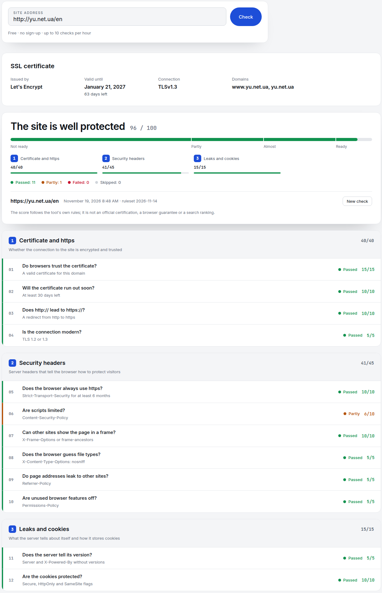

# Security Check

[](LICENSE)
[](composer.json)
[](composer.json)
[](composer.json)
[](https://yu.net.ua/en/tools/security-check)

A Livewire tool for Laravel that checks a site's SSL certificate, its HTTPS setup and its security headers. The visitor enters a URL and gets a scored checklist. Every problem comes with a ready-made nginx and Apache config snippet to fix it.



**🔗 Live example: [yu.net.ua/en/tools/security-check](https://yu.net.ua/en/tools/security-check)**

## What it checks

12 checks in three groups. The result is a score out of 100 and a verdict.

| Group | Points | Checks |
|---|---|---|
| **Certificate and https** | 40 | Trusted certificate, expiry date, `http://` redirects to `https://`, TLS version |
| **Security headers** | 45 | HSTS, Content-Security-Policy, framing protection, `X-Content-Type-Options: nosniff`, Referrer-Policy, Permissions-Policy |
| **Leaks and cookies** | 15 | Server version leaks, `Secure` / `HttpOnly` / `SameSite` cookie flags |

The certificate is read even when browsers don't trust it, so the report can explain the problem: expired, wrong host or self-signed.

## Requirements

- PHP ^8.4 with the `openssl` extension
- Laravel ^13.0
- Livewire ^4.0

## Installation

```bash
composer require yu-laravel/laravel-security-check
```

This also installs [`yu-laravel/laravel-web-tools-core`](https://github.com/yuriyakishin/laravel-web-tools-core). Both service providers are discovered automatically.

## Usage

Put the component on a page whose layout includes `@livewireStyles` and `@livewireScripts`:

```blade
<livewire:security-check />
```

Import the styles into your CSS build:

```css
@import "../../vendor/yu-laravel/laravel-web-tools-core/resources/css/web-tools-core.css";
@import "../../vendor/yu-laravel/laravel-security-check/resources/css/security-check.css";
```

To match your site's colours and fonts, override the `--wt-*` variables (see [Web Tools Core](https://github.com/yuriyakishin/laravel-web-tools-core#styles)).

## Configuration

| Env variable | Default | Description |
|---|---|---|
| `SECURITY_CHECK_ENABLED` | `true` | Turn the tool off without uninstalling it. |
| `SECURITY_CHECK_PER_HOUR` | `10` | Checks per visitor IP per hour. |

A report is cached for 2 minutes, so a server change shows up on the next check. Page fetching (timeouts, redirects, user agent) is set in [Web Tools Core](https://github.com/yuriyakishin/laravel-web-tools-core#configuration).

## Events

After every check the tool dispatches `Yu\WebToolsCore\Events\ToolCheckedEvent` with `tool = "security-check"` (see [Listening to checks](https://github.com/yuriyakishin/laravel-web-tools-core#listening-to-checks)).

## Languages

13 translations: cs, de, en, es, fr, it, ja, nl, pl, pt, tr, uk and zh. The language is taken from the visitor's browser, with your app locale as the fallback.

## Limitations

The TLS check sees only the version the server negotiates, so it can't tell whether old TLS 1.0 and 1.1 are still enabled.

## Author

Yuriy Akishin:
- 🌐 Website: https://yu.net.ua
- 📧 Email: yuriy.akishin@gmail.com
- 💼 LinkedIn: https://www.linkedin.com/in/yuriyakishin/
- 💻 GitHub: https://github.com/yuriyakishin

## License

MIT. See [LICENSE](LICENSE).
